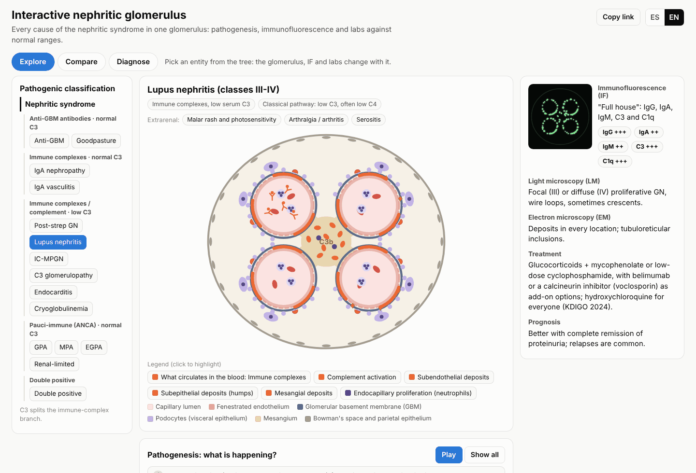

# Glomérulo nefrítico interactivo · Interactive nephritic glomerulus

Every cause of the **nephritic syndrome** drawn in **one glomerulus**: how each disease injures it (pathogenesis), what the biopsy shows (immunofluorescence, light and electron microscopy) and how the labs differ from normal. Explore one entity, compare two side by side, or diagnose unnamed cases.

**Live demo:** https://ferasmed-dev.github.io/nephritic-glomerulus/ · English: https://ferasmed-dev.github.io/nephritic-glomerulus/?lang=en



> Teaching tool · not for clinical use.

## What it shows

- **15 entities** in the classical pathogenic tree of the nephritic syndrome. The serum C3 splits the immune-complex branch:
  - **Anti-GBM antibodies** (normal C3): anti-GBM disease, Goodpasture syndrome
  - **Immune complexes, normal C3**: IgA nephropathy, IgA vasculitis (Henoch-Schönlein)
  - **Immune complexes / complement, low C3**: post-streptococcal GN, lupus nephritis (III-IV), immune-complex MPGN, C3 glomerulopathy, endocarditis-associated GN, cryoglobulinemic GN
  - **Pauci-immune (ANCA)** (normal C3): GPA, MPA, EGPA, renal-limited ANCA vasculitis
  - **Double positive** anti-GBM + ANCA (RPGN type IV)
- **The glomerulus redraws itself for each entity**: circulating antibodies or complexes, complement activation, deposits (linear IgG, subendothelial, subepithelial humps, mesangial, dense intramembranous), endocapillary or mesangial proliferation, double contours, cryoglobulin pseudothrombi, fibrinoid necrosis with GBM rupture and crescents. A step-by-step "What is happening?" panel lights up each layer in order.
- **Immunofluorescence panel** with the matching pattern (linear, "starry sky", granular, "full house", mesangial IgA, C3-only, negative) and the immunoreactants.
- **Labs against normal ranges**: 19 parameters (urine sediment, kidney function, blood pressure, edema, C3, C4, ASO, serum IgA, anti-GBM, PR3/MPO-ANCA, ANA/anti-dsDNA, cryoglobulins, C3NeF, eosinophils), each drawn on its normal band with an arrow and a label, so abnormal values never rely on colour alone.
- **Time models** where time is the lesson:
  - *Post-streptococcal GN*: latency (~10 days after pharyngitis, ~3 weeks after impetigo), then the classic recovery order, with a switch for an atypical course in which C3 never recovers.
  - *IgA nephropathy*: gross hematuria 1-3 days after a pharyngitis ("synpharyngitic").
  - *Rapidly progressive GN (types I, III, IV)*: crescents forming, scarring and healing, with a slider for the day treatment starts and a no-treatment counterfactual.
- **Three modes**: *Explore*, *Compare* (only the findings that tell two entities apart are highlighted) and *Diagnose* (random reproducible cases checked by a rule engine that explains its reasoning).
- Spanish (default) and English, light and dark themes, keyboard-usable, every chart has a data-table view.

## Curriculum fit

For **students and teachers at any Spanish medical faculty**. The topic belongs to the shared national core (Orden ECI/332/2008):

| | |
|---|---|
| Topic | Nephritic syndrome and glomerulonephritis: pathogenesis, immunofluorescence, serology |
| Module | Formación clínica humana (with Morfología, estructura y función for the immunopathology) |
| Typical subjects | Nefrología / Patología médica, Fisiopatología, Anatomía patológica, Inmunología |
| MIR | Highly relevant: complement-based differential (low vs normal C3), RPGN types, latency of post-streptococcal GN vs IgA nephropathy, ANCA patterns |

Topic metadata for catalogues is in [`curriculum.json`](curriculum.json).

## For teachers

Every scenario has a deep link you can project or share. Add `&lang=en` for English. "Copy link" in the app copies the exact state on screen.

| Link | Scenario |
|---|---|
| [`?preset=faringitis-nino`](https://ferasmed-dev.github.io/nephritic-glomerulus/?preset=faringitis-nino) | Child, day 14 after a pharyngitis: full nephritic syndrome, low C3, raised ASO |
| [`?preset=impetigo`](https://ferasmed-dev.github.io/nephritic-glomerulus/?preset=impetigo) | Post-streptococcal GN after impetigo (3-week latency, ASO often normal) |
| [`?preset=c3-persistente`](https://ferasmed-dev.github.io/nephritic-glomerulus/?preset=c3-persistente) | Atypical course: C3 still low at day 100 → biopsy |
| [`?preset=hematuria-sinfaringitica`](https://ferasmed-dev.github.io/nephritic-glomerulus/?preset=hematuria-sinfaringitica) | IgA nephropathy: gross hematuria 2 days after a pharyngitis |
| [`?preset=purpura-nino`](https://ferasmed-dev.github.io/nephritic-glomerulus/?preset=purpura-nino) | IgA vasculitis in a child |
| [`?preset=lupus`](https://ferasmed-dev.github.io/nephritic-glomerulus/?preset=lupus) | Lupus nephritis: low C3 and C4, positive ANA |
| [`?preset=gnmp`](https://ferasmed-dev.github.io/nephritic-glomerulus/?preset=gnmp) | Immune-complex MPGN |
| [`?preset=c3-glomerulopatia`](https://ferasmed-dev.github.io/nephritic-glomerulus/?preset=c3-glomerulopatia) | C3 glomerulopathy (C3NeF) |
| [`?preset=endocarditis`](https://ferasmed-dev.github.io/nephritic-glomerulus/?preset=endocarditis) | Endocarditis-associated GN |
| [`?preset=crioglobulinemia`](https://ferasmed-dev.github.io/nephritic-glomerulus/?preset=crioglobulinemia) | Cryoglobulinemic GN (HCV) |
| [`?preset=anti-mbg`](https://ferasmed-dev.github.io/nephritic-glomerulus/?preset=anti-mbg) | Kidney-limited anti-GBM disease, treated on day 7 |
| [`?preset=hemoptisis-irpr`](https://ferasmed-dev.github.io/nephritic-glomerulus/?preset=hemoptisis-irpr) | Goodpasture syndrome treated early (day 5) |
| [`?preset=goodpasture-tardio`](https://ferasmed-dev.github.io/nephritic-glomerulus/?preset=goodpasture-tardio) | Goodpasture syndrome treated late (day 42) → kidney failure |
| [`?preset=anca-pr3`](https://ferasmed-dev.github.io/nephritic-glomerulus/?preset=anca-pr3) | GPA (PR3-ANCA) |
| [`?preset=anca-mpo`](https://ferasmed-dev.github.io/nephritic-glomerulus/?preset=anca-mpo) | Microscopic polyangiitis (MPO-ANCA) |
| [`?preset=egpa`](https://ferasmed-dev.github.io/nephritic-glomerulus/?preset=egpa) | EGPA: eosinophilia, milder kidney involvement |
| [`?preset=vasculitis-renal`](https://ferasmed-dev.github.io/nephritic-glomerulus/?preset=vasculitis-renal) | Renal-limited ANCA vasculitis diagnosed late (day 28) |
| [`?preset=doble-positivo`](https://ferasmed-dev.github.io/nephritic-glomerulus/?preset=doble-positivo) | Double positive anti-GBM + ANCA (RPGN type IV) |
| [`?preset=postinfecciosa-vs-iga`](https://ferasmed-dev.github.io/nephritic-glomerulus/?preset=postinfecciosa-vs-iga) | Compare: post-streptococcal GN vs IgA nephropathy (latency chart) |
| [`?preset=lupus-vs-gnmp`](https://ferasmed-dev.github.io/nephritic-glomerulus/?preset=lupus-vs-gnmp) | Compare: lupus nephritis vs MPGN |
| [`?preset=goodpasture-vs-gpa`](https://ferasmed-dev.github.io/nephritic-glomerulus/?preset=goodpasture-vs-gpa) | Compare: two pulmonary-renal syndromes |
| [`?preset=iga-vs-vasculitis-iga`](https://ferasmed-dev.github.io/nephritic-glomerulus/?preset=iga-vs-vasculitis-iga) | Compare: IgA nephropathy vs IgA vasculitis |
| [`?preset=quiz`](https://ferasmed-dev.github.io/nephritic-glomerulus/?preset=quiz) | Diagnose mode; `?mode=quiz&case=<number>` opens the same case for the whole class |

You can also link any entity directly: `?mode=explore&entity=<id>` with `gnape, igan, igav, lupus, mpgn, c3g, endocarditis, cryo, antigbm, goodpasture, gpa, mpa, egpa, rlv, double`, plus `&day=`, `&tx=` (or `tx=none`), `&site=skin`, `&atypical=1`.

## The model

All logic is in [`src/model.js`](src/model.js): pure functions, no DOM, tested in Node.

### Normal ranges

Approximate adult references (each laboratory has its own; the app says so).

| Parameter | Normal | Basis |
|---|---|---|
| Hematuria | ≤ 3 red cells/field | Standard sediment cut-off |
| Dysmorphic red cells, red-cell casts | Absent | Glomerular origin / active sediment |
| eGFR | ≥ 90 mL/min/1.73 m² | KDIGO G1 |
| Proteinuria | < 0.15 g/24 h (nephrotic range ≥ 3.5 g/24 h marked) | Standard |
| Urine output | 800-2000 mL/24 h (oliguria < 400 marked) | Standard |
| Systolic BP | < 130 mmHg adult; < 115 mmHg school-age child | Adult guideline threshold; child ≈ 95th percentile (**Model**) |
| C3 / C4 | 90-180 / 10-40 mg/dL | Common laboratory ranges |
| ASO titre | < 200 IU/mL | Common adult cut-off |
| Serum IgA | 70-400 mg/dL | Common laboratory range |
| Anti-GBM, PR3-ANCA, MPO-ANCA, ANA/anti-dsDNA | Index < 1 | Shown as value / assay cut-off |
| Cryoglobulins, C3NeF | Negative | |
| Eosinophils | < 0.5 × 10⁹/L | Standard |

### Entities

Each entity has a mechanism, complement pathway, deposit sites, IF pattern, typical labs at presentation (a range per parameter; the app shows the midpoint and quiz cases draw inside the range), extrarenal signs and, for RPGN, crescent-model settings. Key facts encoded:

| Entity | C3 / C4 | Signature | IF |
|---|---|---|---|
| Anti-GBM / Goodpasture | N / N | Anti-GBM +, ± lung hemorrhage | Linear IgG |
| IgA nephropathy / IgA vasculitis | N / N | Serum IgA ↑ (50-70 %), latency 1-3 d; purpura in IgAV | Mesangial IgA + C3 |
| Post-streptococcal GN | ↓ / N | ASO ↑, latency ~10 d (throat) / ~3 wk (skin), alternative pathway | Coarse granular "starry sky", humps on EM |
| Lupus nephritis | ↓ / ↓ | ANA / anti-dsDNA + | "Full house" with C1q |
| Immune-complex MPGN | ↓ / N or ↓ | HCV, autoimmunity, gammopathy | Granular IgG + C3, double contours |
| C3 glomerulopathy | ↓↓ / N | C3NeF | C3 without Ig |
| Endocarditis GN | ↓ / N or ↓ | Fever, murmur, blood cultures | Granular |
| Cryoglobulinemic GN | ↓ / ↓↓ | Cryoglobulins +, HCV | Granular IgM/IgG, pseudothrombi |
| GPA / MPA / EGPA / renal-limited | N / N | ANCA: GPA PR3 ~75 %; MPA MPO ~60 %; EGPA ANCA+ only ~40 % (MPO); renal-limited MPO ~80 % | Negative (pauci-immune) |
| Double positive | N / N | Anti-GBM + ANCA | Linear IgG |

### Post-streptococcal GN time course

Day 0 is the infection. Onset after the latency (10 days throat, 21 days skin, **Model** within the standard 1-3 / 3-6 weeks). Each parameter recovers with a smooth step between two times after onset (**Model**, following the classic course):

| Parameter | Onset value | Recovers between (days after onset) |
|---|---|---|
| Edema | +++ | 4-10 |
| Urine output | 400 mL/24 h | 2-10 |
| Gross → microscopic hematuria | 80 → 12 /field | 7-21 |
| Systolic BP (child) | 138 mmHg | 7-21 |
| eGFR | 62 | 7-42 |
| C3 | 40 mg/dL | 28-60 (normal by ~8 weeks) |
| Proteinuria | 1.0 g/24 h | 14-150 |
| Microhematuria | 12 /field | 60-180 (gone by ~6 months) |

ASO rises from day 7 to a peak at ~day 28 (700 IU/mL after pharyngitis; only 190 IU/mL after skin infection, because it rises in only ~30 % of skin infections) and falls slowly. *Atypical course*: C3, microhematuria and proteinuria never recover.

### Crescent model (rapidly progressive GN, **Model**)

Glomeruli are normal (N), with a cellular crescent (Ce) or with a fibrous crescent (F), as fractions summing to 1:

```
dN/dt  = −k·a(t)·N + r·Ce·[treated]
dCe/dt =  k·a(t)·N − c·Ce − r·Ce·[treated]
dF/dt  =  c·Ce
a(t)   = 1 before treatment, exp(−(t − t_tx)/τ) after
eGFR   = 105 · (N + 0.4·Ce)
```

| Parameter | Value | Basis |
|---|---|---|
| k (crescent formation) | 0.09/day anti-GBM and double positive; 0.05/day ANCA; 0.02/day EGPA | Tuning: anti-GBM is the most aggressive, EGPA kidney involvement the mildest |
| c (cellular → fibrous) | 0.06/day | Tuning: cellular crescents scar over ~2-3 weeks |
| r (healing on treatment) | 0.10/day | Tuning: cellular crescents can resolve, fibrous ones cannot |
| τ (activity fades after treatment) | 4 days | Tuning |
| 0.4 | Residual filtration of a glomerulus with a cellular crescent | Tuning |
| 15 mL/min/1.73 m² | Kidney failure line | KDIGO G5 |

Euler integration, dt = 0.05 day.

### Rule engine

`classify()` reproduces the classical stepwise reasoning: anti-GBM or linear IF → anti-GBM branch (lung → Goodpasture; ANCA too → double positive); ANCA or negative IF → pauci-immune (eosinophilia/asthma → EGPA, PR3/upper airway → GPA, no extrarenal signs → renal-limited, else MPA); otherwise immune complexes split by C3 (normal: purpura → IgA vasculitis, else IgA nephropathy; low: ANA → lupus, cryoglobulins → cryoglobulinemic GN, C3NeF/C3-only IF → C3 glomerulopathy, fever/murmur → endocarditis, streptococcal latency or ASO → post-streptococcal GN, else MPGN). The tests check that it recovers the right entity from every entity's typical findings and from 600 generated quiz cases.

## Presets: expected results

| Preset | Expected |
|---|---|
| `faringitis-nino` | Hematuria 80/field with casts, eGFR 62, oliguria 541 mL, BP 138, edema +++, C3 40, C4 normal, ASO 256 |
| `impetigo` | Day 30 (9 days after onset): hematuria 76/field, C3 40, **ASO normal** |
| `c3-persistente` | Day 100: C3 still 40 → atypical, biopsy |
| `hematuria-sinfaringitica` | Day 2: hematuria 80/field, C3 normal, serum IgA 490 |
| `anti-mbg`, `doble-positivo` | Treated day 7: 36 % crescents at day 21, eGFR 71; day 120 eGFR 73 |
| `hemoptisis-irpr` | Treated day 5: 26 % crescents at day 30, eGFR 78; no dialysis |
| `goodpasture-tardio` | Treated day 42: 88 % fibrous crescents, eGFR 13 → kidney failure |
| `anca-pr3` | Treated day 10: 28 % crescents at day 30, eGFR 77 |
| `anca-mpo` | Treated day 14: 37 % crescents at day 30, eGFR 68 |
| `egpa` | Treated day 14: 18 % crescents, eGFR 87, eosinophils 2.75 × 10⁹/L |
| `vasculitis-renal` | Treated day 28: 61 % crescents at day 45, eGFR 43 |
| no treatment | Kidney failure by day 120: eGFR < 1 in anti-GBM and GPA, 11 in EGPA |

## Known simplifications

- The glomerulus is a schematic cross-section of four capillary loops, not histology. Deposit positions are typical, not exhaustive (e.g. lupus can deposit everywhere).
- The time courses and the crescent model are teaching models (**Model** tag) tuned to the classic clinical course, not fitted to patient data.
- Each entity is shown at its typical presentation; real patients vary (ANCA-negative GPA, C3 normal post-infectious GN, nephrotic-range lupus…).
- Normal ranges are approximate adult values; children have lower BP limits and labs use their own ranges.
- RPGN type II (immune-complex crescentic GN) is mentioned in the entities that can produce it but has no crescent model of its own.

## Layout

```
index.html          page shell
src/model.js        data, normal ranges, dynamics, rule engine, presets (pure)
src/i18n.js         ES + EN text
src/glomerulus.js   SVG glomerulus and IF panel
src/charts.js       dependency-free SVG charts with hover and table view
src/ui.js           DOM, modes, deep links (exposes window.__sim)
src/styles.css      light/dark styles
tests/model.test.js node:test suite
curriculum.json     topic metadata
```

## Run locally

No build step:

```bash
python3 -m http.server 8000
# open http://localhost:8000/
```

## Tests

```bash
npm test   # node --test (Node 18+)
```

GitHub Actions runs the tests on every push (`.github/workflows/test.yml`).

## Deploy (GitHub Pages)

Settings → Pages → Deploy from a branch → `main` / `(root)`. The site appears at `https://ferasmed-dev.github.io/nephritic-glomerulus/`.

## References

- KDIGO 2021 Clinical Practice Guideline for the Management of Glomerular Diseases. *Kidney Int* 2021;100(4S):S1-S276.
- KDIGO 2024 Clinical Practice Guideline for the Management of Antineutrophil Cytoplasmic Antibody (ANCA)-Associated Vasculitis. *Kidney Int* 2024;105(3S):S71-S116.
- KDIGO 2024 Clinical Practice Guideline for the Management of Lupus Nephritis. *Kidney Int* 2024;105(1S):S1-S69.
- KDIGO 2025 Clinical Practice Guideline for the Management of IgA Nephropathy and IgA Vasculitis. *Kidney Int* 2025;108(4S):S1-S71.
- KDIGO 2024 Clinical Practice Guideline for the Evaluation and Management of CKD (GFR categories).
- Jennette JC, et al. 2012 Revised International Chapel Hill Consensus Conference Nomenclature of Vasculitides. *Arthritis Rheum* 2013;65:1-11.
- Kitching AR, et al. ANCA-associated vasculitis. *Nat Rev Dis Primers* 2020;6:71 (ANCA specificity by phenotype: GPA PR3 ~75 %, MPA MPO ~60 %).
- Rodríguez-Iturbe B, Haas M. Post-streptococcal glomerulonephritis. In: *Streptococcus pyogenes: Basic Biology to Clinical Manifestations*. 2016.
- Sethi S, Fervenza FC. Membranoproliferative glomerulonephritis — a new look at an old entity. *N Engl J Med* 2012;366:1119-31.
- Smith RJH, et al. C3 glomerulopathy — understanding a rare complement-driven renal disease. *Nat Rev Nephrol* 2019;15:129-43.
- Farreras-Rozman. *Medicina Interna*, sección de Nefrología (glomerulonefritis). Elsevier.
- Feehally J, Floege J, Tonelli M, Johnson RJ. *Comprehensive Clinical Nephrology*, 7th ed. Elsevier.

## License

[MIT](LICENSE) © 2026 Feras Elhissi
